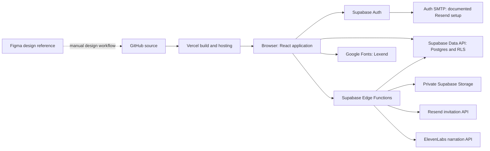

# Systems reference

Repository-derived reference, reviewed November 2, 2026 at application commit
`24180c8`. Hosted service settings have not been checked for this documentation.
Start with the [outline](README.md); use [operations](development.md) for commands
and configuration locations.

## Architecture

Dot Reading is a browser application with a hosted Supabase backend. There is no
separate Node application server in this repository. Node runs development and
build tools; Supabase Edge Functions run server code in Deno.

The GitHub-to-Vercel connection is the deployment workflow described in the
repository. Its actual linked project/branch and current deployment need hosted
verification. Figma changes do not deploy code.

## Service and tool inventory

| System | Role and boundary | Local evidence |
| --- | --- | --- |
| Git / GitHub | Source/version history; configured origin is `https://github.com/cjg9/reading_program.git` | Local Git remote; [project README](../README.md) |
| React + React DOM | Browser UI, hooks, in-memory screen state; version 19.2.8 | [package.json](../package.json), [main.tsx](../src/main.tsx) |
| TypeScript | Strict frontend/config checks; version 5.9.3 | [tsconfig.app.json](../tsconfig.app.json), [tsconfig.node.json](../tsconfig.node.json) |
| Vite + React plugin | Dev server and static production bundle; Vite 7.3.6 | [vite.config.ts](../vite.config.ts), `package.json` |
| Node + npm | Local dependency installation, scripts, lockfile; Node >=22.12 | `package.json`, [package-lock.json](../package-lock.json) |
| Vercel | Hosts `dist`, builds with `npm run build`, rewrites paths to `index.html` | [vercel.json](../vercel.json) |
| Supabase JS | Browser/server SDK; version 2.112.3 | [supabase.ts](../src/lib/supabase.ts), function imports |
| Supabase Auth | Identity, email/password, confirmation, persisted/refreshing sessions, recovery | [AuthProvider.tsx](../src/auth/AuthProvider.tsx) |
| Supabase Postgres / Data API | Protected records, SQL functions, role/ownership/membership checks | [migrations](../supabase/migrations/) |
| Supabase Edge Functions / Deno | Authorized email delivery and narration requests | [functions](../supabase/functions/), [config.toml](../supabase/config.toml) |
| Supabase Storage | Private `reading-narration` bucket; JSON objects hold base64 MP3 and character alignment | [read-aloud/index.ts](../supabase/functions/read-aloud/index.ts) |
| Resend HTTP API | Sends teacher-issued class invitation emails | [send-class-invitation/index.ts](../supabase/functions/send-class-invitation/index.ts) |
| Auth SMTP | Separate delivery path for confirmation/recovery; existing notes specify Resend SMTP | [invitation setup](invitations.md), [recovery setup](../README.md#password-recovery-teachers-and-students) |
| ElevenLabs | Creates timestamped narration on an authorized cache miss | [read-aloud/handler.ts](../supabase/functions/read-aloud/handler.ts) |
| Figma | Design reference, frame mapping, manual code/design synchronization | [design workflow](design-workflow.md) |
| Google Fonts | Loads Lexend through a CSS import; requires external network access for the font | [styles.css](../src/styles.css) |
| Vitest / Testing Library / jsdom | Unit tests and simulated browser UI tests | [tests](../tests/), `src/lib/*.test.ts` |
| PGlite | Local SQL/migration/permission tests with minimal Supabase fixtures | `tests/*.database.test.ts` |
| Supabase CLI | Optional local backend and linked hosted migration/function management | `supabase/config.toml`, [operations](development.md) |

Excel/Google Sheets supply pasted text only: there is no spreadsheet account/API
integration. There is no application runtime dependency on OpenAI, an AI agent,
Google/SSO sign-in, an LMS, paid-plan billing, or a notification queue in the
inspected code. Supabase's generated config includes additional platform features
such as Realtime, vector storage, and disabled external providers; their presence
does not mean the app uses them. No Realtime subscription was found.

## Frontend structure and routes

[index.html](../index.html) -> [main.tsx](../src/main.tsx) ->
[App.tsx](../src/App.tsx) -> [AuthProvider](../src/auth/AuthProvider.tsx).
Routing uses `window.location.pathname`, ordinary links, and component state;
there is no router dependency. Class selections and practices are not URL routes.

| Path | Current behavior |
| --- | --- |
| `/`, `/welcome` | Public welcome page, including for signed-in users; recovery callbacks take priority |
| `/teacher` | Teacher sign-in/signup, then teacher dashboard for a matching profile |
| `/student` | Student sign-in/signup, then student dashboard for a matching profile |
| `/teacher?mode=sign-up`, `/student?mode=sign-up` | For signed-out users, open portal in signup mode |
| `/student/invite?token=...` | Preview personal invitation, authenticate using recipient email, explicitly join |
| `/teacher/forgot-password`, `/student/forgot-password` | Request password-reset email; neutral confirmation |
| `/teacher/reset-password`, `/student/reset-password` | Password form before ordinary profile/dashboard routing |
| Other paths | Not-found screen linking to the portals |

Trailing slashes are normalized. Opening the wrong portal shows a role mismatch
screen, not a role conversion. Missing client configuration, failed sessions, and
unavailable profiles have separate setup/error/retry screens.

| UI area | Primary code | State/data behavior |
| --- | --- | --- |
| Teacher classroom menu | [TeacherDashboard.tsx](../src/components/TeacherDashboard.tsx) | Owned classes, create/search, teacher access ordering, global My Practices |
| Student classroom menu | [StudentDashboard.tsx](../src/components/StudentDashboard.tsx) | Enrolled classes, independent student access timestamps |
| Class workspace | [ClassWorkspace.tsx](../src/components/ClassWorkspace.tsx) | Overview, Students, Statistics; keeps invitation panel mounted across tabs |
| People and invitations | [ClassPeople.tsx](../src/components/ClassPeople.tsx), [InviteTable.tsx](../src/components/InviteTable.tsx) | Named roster, sends/retries, revoke, confirmed removal |
| Invitation acceptance | [InvitationPage.tsx](../src/components/InvitationPage.tsx) | Preserves invite through signup/confirmation; removes token from current history entry after joining |
| Teacher practice library | [TeacherExercises.tsx](../src/components/TeacherExercises.tsx) | Create/edit/customize/preview/delete; distribute to selected classes; unassign and view progress |
| Student assignments | [StudentExercises.tsx](../src/components/StudentExercises.tsx) | Active class assignments; checked answers/hints and completion through RPC |
| Game engine/player | [exercises.ts](../src/lib/exercises.ts), [ExercisePlayer.tsx](../src/components/ExercisePlayer.tsx) | Challenge generation, saved manifests, answer checks, hints, preview |
| Narration | [ReadAloud.tsx](../src/components/ReadAloud.tsx), [ElevenLabsReadAloud.tsx](../src/components/ElevenLabsReadAloud.tsx), [narration.ts](../src/lib/narration.ts) | Cached audio, clock-based highlighting, sentence/position controls |
| Statistics | [reading-overview.ts](../src/lib/reading-overview.ts), [ClassInsights.tsx](../src/components/ClassInsights.tsx) | Completion from current memberships and active assignments |

Selections, searches, invitation drafts, and unsaved practice drafts are React
memory. Supabase SDK persists the auth session in browser storage. Checked student
work is stored remotely; unchecked input is not. Leaving Practices discards its
unsaved editor draft. Reloading normally returns to the portal's class menu.

CSS loads `styles.css`, `design.css`, then `practices.css`; shared teacher/student
themes use purple/teal. Assets live in [public/design](../public/design/) and
[favicon.svg](../public/favicon.svg), so production does not require Figma asset
URLs. The wordmark is text/CSS. Relevant browser APIs include `Intl.Segmenter`,
Web Crypto, HTML Audio, Blob/object URLs, animation frames, visibility events,
native dialogs, and reduced-motion media queries.

## Identity and permission boundaries

Supabase Auth owns identity, verified email, passwords, and session tokens.
`public.profiles.account_type` owns the application role. The signup trigger
`app_private.create_profile_for_new_user()` sets student for
`signup_portal=student`, otherwise teacher; existing accounts were backfilled as
teachers. Browser clients can read their own profile but cannot update its role.

All application tables enable RLS and have explicit grants. RLS limits which
records are visible; column grants and SQL functions limit mutations. Important
exceptions to a naive CRUD approach:

- Teacher roster reads use `class_roster_named`; direct membership SELECT is
  student-self only and returns no rows for teachers.
- Class creation uses an allowed `classes.name` insert; class/membership access
  updates are limited to `last_accessed_at`. Membership enrollment/deletion uses
  authorized functions, not browser inserts/deletes.
- Practice, assignment, and progress mutations use SQL functions with validation.
- Narration tables and audio objects have no direct browser access. Edge Functions
  use caller-scoped reads to establish permission before privileged operations.
- Both functions set `verify_jwt=false` at the gateway and explicitly validate the
  bearer token with Auth `getUser(jwt)`, requiring a confirmed email. Do not remove
  these handler checks. A public publishable key is not a substitute for a user JWT.
- The service-role key bypasses RLS and stays server-side. SQL functions using
  `security definer` explicitly check callers and set an empty search path.

## Data model

All unqualified application table names below are in `public`; migrations are the
canonical column/constraint reference. Classes use numeric IDs; most other entity
IDs are UUIDs. Content, challenge manifests, and answers/hints use JSONB.

| Table or store | Purpose and relationships |
| --- | --- |
| `auth.users` | Managed identity; source of profile and user references |
| `profiles` | One teacher/student role per Auth user; browser role is immutable |
| `classes` | Owned by a teacher; name, created time, teacher's last access |
| `class_memberships` | PK `(class_id,student_id)`; many-to-many enrollment, class/owner consistency, student role, joined and student access time |
| `class_invitations` | Unique `(class_id,email)`; names, hashed token, expiry, accepted/revoked/delivery state; raw token is not stored |
| `app_private.invitation_send_attempts` | Teacher send-attempt history for throttling; privileged routines only |
| `reading_exercises` | Teacher-owned reusable practice JSON or shared preset with `preset_key` |
| `exercise_assignments` | Class/owner, nullable source exercise, immutable content snapshot, archive time, optional `narration_id` |
| `exercise_progress` | PK `(assignment_id,student_id)`; answers/hints JSON and completion/update times |
| `narration_limits` | Singleton: default global monthly and per-user daily character budgets |
| `narration_cache` | Hash key, pending/ready/failed state, generation lease, stored object path |
| `narration_usage` | Requesting account, attempted generation characters, time |
| `narration_publications` | Exercise/content hash, content snapshot, cache key; assignment pins this ID |
| Storage `reading-narration` | Private JSON recording at `<cacheKey>/<leaseId>.json`; base64 MP3 plus original character alignment |

Deleting a saved practice sets the source reference null on assignments and
publications; assigned content, saved work, and published audio survive. Unassign
archives the assignment. Removing enrollment revokes access but does not delete
the student's account or saved work. No application audio garbage-collection or
general retention job was found.

### Database interfaces

Use `client.rpc(name, parameters)`. Read exact types/validation in
[migrations](../supabase/migrations/) before changing an interface. The table
lists argument names in order; defaults are noted.

| Function | Arguments | Caller/purpose |
| --- | --- | --- |
| `class_roster_named` | `p_class_id` | Owning teacher; current named roster |
| `class_roster` | `p_class_id` | Owning teacher; retained legacy unnamed roster |
| `preview_class_invitation` | `p_token_hash` | Anonymous/authenticated bearer preview; no enrollment |
| `accept_class_invitation` | `p_token_hash` | Confirmed matching-email student; atomic join |
| `revoke_class_invitation` | `p_invitation_id` | Owning teacher; revoke unused invitation |
| `remove_class_student` | `p_class_id`, `p_student_id` | Owning teacher; revoke old invites and remove selected membership |
| `prepare_class_invitation` | `p_teacher_id`, `p_class_id`, `p_email`, `p_token_hash` | Service-only send preparation, validation, quotas, token rotation |
| `prepare_named_class_invitation` | Above plus `p_first_name`, `p_last_name` | Service-only named send preparation; used by current mail function |
| `save_reading_exercise` | `p_content`, `p_exercise_id=null` | Teacher create/update own practice |
| `delete_reading_exercise` | `p_exercise_id` | Teacher delete own saved non-preset practice |
| `assign_reading_exercise` | `p_class_id`, `p_exercise_id`, `p_narration_id=null` | Owner; requires ready matching narration for publication |
| `unassign_reading_exercise` | `p_assignment_id` | Owner archives assignment |
| `save_exercise_progress` | `p_assignment_id`, `p_progress`, `p_complete=false` | Current student member; checked save/completion |
| `reserve_narration` | `p_key`, `p_user`, `p_characters` | Service-only serialized cache reservation and quotas |

The latest assignment RPC has three arguments. The publication migration drops
the old two-argument version. A null narration default does not permit new
publication without a matching ready recording.

## End-to-end flows

### Signup, sessions, and recovery

Portal signup supplies role metadata -> Auth creates identity -> database trigger
creates protected profile -> user confirms email -> SDK restores session -> app
loads role and opens the matching dashboard. Profile loading failures offer retry.
Sign-out uses local session scope.

Forgot password -> Auth reset email via configured SMTP -> allowed reset URL ->
callback/session validation -> new password form before dashboard routing -> Auth
updates password -> continue to portal. Neutral request confirmation does not
reveal account existence. See the [recovery runbook](../README.md#password-recovery-teachers-and-students).

### Invitations and class moderation

Teacher enters/pastes names and email -> local validation -> one
`send-class-invitation` invocation per recipient with
`{classId,email,firstName,lastName}` -> Auth/owner checks -> service-only SQL
preparation -> Resend HTTP request -> delivery status saved. Server generates a
32-byte random token and stores its SHA-256 digest. Email carries the raw token.

Student opens link -> browser hashes token for preview -> sign-in/signup and
confirmation with the invited email -> explicit Join class -> transactional
acceptance RPC -> membership. The client does not enroll users by itself.

UI batches allow 30 rows, pace requests, retain per-row results, and retry only
unsent rows. Server defaults: 30 attempts per teacher per rolling hour, one-minute
resend cooldown per class/email, seven-day link expiry. Failed sends count as
attempts; provider acceptance is not proof of inbox delivery. There is no webhook
or background retry worker. Resending rotates the token. Removal revokes old
invitations and deletes only the selected membership; a fresh invitation can rejoin.

### Practices, assignment snapshots, and student work

One original Dog Detectives passage has four seeded game variants. Ten strategy
keys are `missing`, `endings`, `upside`, `scramble`, `digraphs`, `backwards`,
`nonsense`, `synonym`, `definition`, `mixed`. See [game definitions](../src/lib/exercises.ts).

Create/customize -> validate -> save content plus `challenges` manifest -> prepare
narration for the owned saved exercise -> assign independently to each selected
class with publication ID. Partial distribution success is retained and reported.
The saved library practice and each classroom assignment are separate records.
Shared presets must be customized and saved as a teacher-owned practice before
publication; current preparation and assignment require an owned exercise.

Saved manifests preserve whitespace-aware token indexes and historical answers;
do not regenerate assigned challenges when changing game algorithms. Repeating
an active assignment keeps its existing version/work. Unassign then reassign to
distribute a revised version. Customize creates a copy; Edit updates the library
record only. Current upside-down generation chooses the shortest complete
sentence per paragraph and rotates it until all its words are solved. Old assigned
manifests retain their original behavior.

Student chooses a word -> submits answer or hint -> RPC validates current access
and progress -> UI reflects accepted save. Unchecked text is not saved. Finish
requires all challenges correct, checked independently by SQL; completed work is
immutable. Incomplete saves from multiple tabs use the last successful save.
Answers exist in client-visible content: this is practice, not secure assessment.

Content validation allows a title up to 120 characters, passage 40–20,000
characters, up to 50 target/priority words and at most 40 challenges. Narration's
5,000 spoken-character cap is stricter than the editor's passage cap.

### Narration, storage, and cost controls

The browser invokes `read-aloud`; [index.ts](../supabase/functions/read-aloud/index.ts)
wires the production [publication handler](../supabase/functions/read-aloud/publication.ts)
to Auth, caller-scoped reads, private storage, and the internal generation handler.

| Action | Request fields after `action` | Behavior |
| --- | --- | --- |
| `prepare` | `exerciseId` | Owned saved exercise only; reuse or create matching publication, return `publicationId` |
| `play` | `assignmentId` | Check active assignment access; return its pinned recording |
| `preview` | `content` for teacher, or `assignmentId` | Derive authorized puzzle speech; cache/generate |
| `corrected` | `assignmentId` or teacher `content`, `sentenceStart`, `answers` | Derive sentence from authorized text; restore only matching answers; cache/generate |

Published playback never regenerates a missing pinned recording. Legacy
assignments without a publication can generate/cache their authorized snapshot on
first play. Preview and distinct corrected sentences can also generate on cache
misses. Students cannot submit arbitrary narration text.

Generation -> SHA-256 key over text, voice, model, settings, format, version -> SQL
reservation -> ready/pending/limited/generate -> ElevenLabs timestamped TTS on a
miss -> validate original character alignment -> private Storage JSON -> ready
cache. A two-minute lease coordinates concurrency; the client retries 409 pending
responses every two seconds for up to 35 attempts.

Default application limits are 10,000 new characters globally per UTC calendar
month and 5,000 per requesting account per UTC day; each recording is capped at
5,000 spoken characters. The database reserves budget before the provider call,
so failed attempts count conservatively. Ready cache hits bypass generation
limits. Exactly-once provider billing is not guaranteed across network/storage
failures. Provider credit/voice permissions remain independent of these limits.

HTML Audio plays MP3 with original-text timing, sentence selection, seek,
pause/resume/stop and 0.6×/1×/1.5× speed. Correct saved answers trigger corrected
sentence playback. Audio stops on hidden/unmounted views; stale requests abort
and object URLs are released. There is no current browser speech-synthesis
fallback or narrator selector. See [narration notes](elevenlabs-trial.md).

### Statistics

`loadTeacherMemberships` loads ownership-checked rosters. Expected activities are
current class members × active assignments; completed activities count completed
progress for those pairs. Removed members and archived assignments do not count.
Dashboard enrolled-student totals deduplicate students across classes. Empty
classes have no completion rate; errors expose retry. These are completion
summaries, not grades, Lexile measurements, or advanced analytics.
